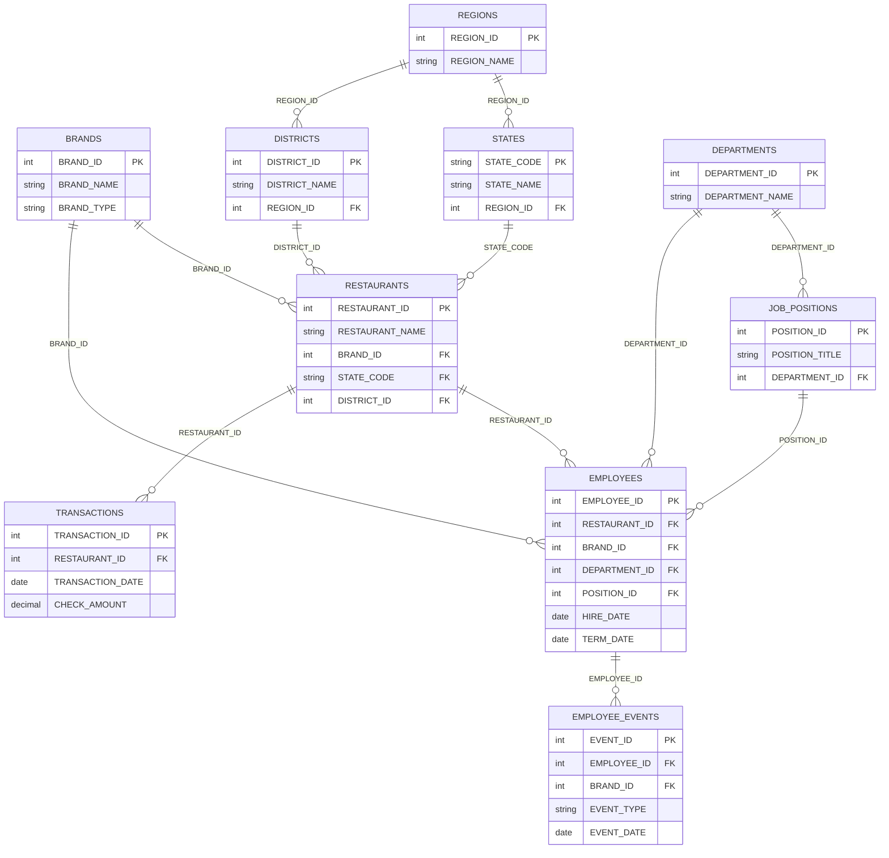

# WKS Restaurant Group — Snowflake Platform Demo

A complete Snowflake Intelligence demo for WKS Restaurant Group: synthetic data generation, an 8-step Dynamic Table pipeline, a Semantic View, Cortex Agent accessible in Snowflake Intelligence, and a React dashboard deployed on SPCS.

**Brands:** Wendy's · Denny's · El Pollo Loco · Krispy Kreme · Blaze Pizza  
**Scope:** ~350 locations · 19 US states · 1.5M synthetic transactions · ~3,500 active + ~1,400 historical-terminated employees (≈ 4,900 total rows in EMPLOYEES)

---

## Quick Start (3 Steps)

### Step 1 — Snowflake prerequisites (run once per account)

```sql
-- 1. Create the API integration for GitHub
USE ROLE ACCOUNTADMIN;
CREATE API INTEGRATION IF NOT EXISTS GIT_HUB_INTEGRATION
  API_PROVIDER = git_https_api
  API_ALLOWED_PREFIXES = ('https://github.com/')
  ENABLED = TRUE;

-- 2. Create the Git Repository object in Snowflake
CREATE DATABASE IF NOT EXISTS CUSTOMER_DEMOS;
CREATE SCHEMA  IF NOT EXISTS CUSTOMER_DEMOS.WKS;

CREATE OR REPLACE GIT REPOSITORY CUSTOMER_DEMOS.WKS.WKS_REPO
  API_INTEGRATION = GIT_HUB_INTEGRATION
  ORIGIN = 'https://github.com/sfc-gh-timjones/c_wks';

ALTER GIT REPOSITORY CUSTOMER_DEMOS.WKS.WKS_REPO FETCH;
```

### Step 2 — Deploy everything

Run `sql/TEARDOWN_AND_REBUILD.sql` in a Snowsight worksheet or paste the contents directly. It tears down any existing objects and rebuilds from scratch using `EXECUTE IMMEDIATE FROM @git_repo`.

> Script 04 (Faker employees) takes ~3 minutes. Scripts 07–08 (Cortex Search) take ~2 minutes to activate. Total build time: ~10 minutes.

### Step 3 — Open Snowflake Intelligence

Navigate to **Snowflake Intelligence → WKS Assistant** and ask a sample question.

---

## Project Structure

| Script | Description | Order |
|--------|-------------|-------|
| `01_database_and_schema.sql` | Database, schema, warehouse, cross-region Cortex | 1 |
| `02_create_tables.sql` | 10 base tables (dims + facts) | 2 |
| `03_generate_synthetic_data.sql` | Synthetic data via SQL GENERATOR (1.5M transactions) | 3 |
| `04_generate_employees_faker.sql` | Faker + numpy employee proc + employee events | 4 |
| `05_create_dynamic_tables.sql` | 8-DT pipeline (1hr → 30min → 15min → 5min → 1min) | 5 |
| `06_create_semantic_view.sql` | WKS_SEMANTIC_VIEW + 9 verified queries (VQRs) | 6 |
| `07_create_cortex_search.sql` | HR policies + brand standards search service | 7 |
| `08_create_email_proc.sql` | WKS_SEND_EMAIL HTML email procedure | 8 |
| `09_create_agent.sql` | WKS_AGENT + Snowflake Intelligence registration | 9 |
| `10_row_access_policy.sql` | District-level row access policy on RESTAURANTS | 10 |
| `99_teardown.sql` | Drop all objects in reverse order | — |
| `TEARDOWN_AND_REBUILD.sql` | One-click rebuild from Git repo | — |

---

## Data Sources (Simulated)

| Source System | Domain | Key Tables |
|---------------|--------|-----------|
| POS (brand-controlled SFTP) | Transactions | `TRANSACTIONS` |
| DayForce HR | Employees + events | `EMPLOYEES`, `EMPLOYEE_EVENTS` |
| Operations | Restaurant master data | `RESTAURANTS`, `DISTRICTS` |
| Corporate master | Brands, regions | `BRANDS`, `REGIONS`, `STATES` |
| HR / IT | Policies, standards | `WKS_HR_DOCS` (Cortex Search) |

---

## Dynamic Table Pipeline

```
TRANSACTIONS (1.5M rows)
    └─▶ DT_TRANSACTIONS_CLEAN          [Bronze, 1 hr]
            └─▶ DT_DAILY_RESTAURANT_SALES   [Silver, 30 min]
                    └─▶ DT_WEEKLY_RESTAURANT_SALES  [Gold, 15 min, FULL REFRESH]
                                └─▶ DT_BRAND_WEEKLY_SUMMARY    [Rollup, 5 min]
                                            └─▶ DT_CURRENT_SNAPSHOT   [Hot, 1 min ★]

EMPLOYEES + EMPLOYEE_EVENTS
    └─▶ DT_EMPLOYEES_ENRICHED          [Bronze, 1 hr]
    └─▶ DT_MONTHLY_BRAND_TURNOVER      [Silver, 30 min]
            └─▶ DT_HR_BRAND_METRICS        [Gold, 15 min, FULL REFRESH]
```

**Grain contract:** Sales facts stay at restaurant × week. HR facts stay at brand × month. They are never physically joined in a DT — the semantic view relates them through the `BRANDS` dimension table.

---

## Agent Tools

| Tool | Type | Purpose |
|------|------|---------|
| `Analyst` | `cortex_analyst_text_to_sql` | Text-to-SQL over WKS_SEMANTIC_VIEW |
| `HRSearch` | `cortex_search` | HR policies, brand operating standards |
| `data_to_chart` | Built-in | Render query results as charts |
| `SendEmail` | `procedure` → `WKS_SEND_EMAIL` | HTML email reports |

---

## Demo Questions

> **VQR** = Verified Query Representation — a pre-validated SQL query baked into the semantic view. These are the most reliable questions to use in a live demo; the agent answers them via the exact verified SQL rather than generating new SQL on the fly. There are **9 VQRs** total.

### Sales Analytics
- **VQR:** What are the top 10 restaurants by total sales this month?
  - *`DT_WEEKLY_RESTAURANT_SALES` (RESTAURANT_NAME, WEEKLY_SALES) + `BRANDS` (BRAND_NAME)*
- **VQR:** How are weekly sales trending by brand over the last 13 weeks?
  - *`DT_WEEKLY_RESTAURANT_SALES` (WEEKLY_SALES, WEEK_START_DATE) + `BRANDS` (BRAND_NAME)*
- **VQR:** What is our week-over-week sales change by region?
  - *`DT_WEEKLY_RESTAURANT_SALES` (REGION_NAME, WEEKLY_SALES, WOW_CHANGE_PCT)*
- **VQR:** What are our top 5 performing states by total revenue this quarter?
  - *`DT_WEEKLY_RESTAURANT_SALES` (STATE_CODE, WEEKLY_SALES)*
- **VQR:** What is the average check size by brand?
  - *`DT_WEEKLY_RESTAURANT_SALES` (AVG_CHECK) + `BRANDS` (BRAND_NAME)*
- Which regions are growing the fastest right now?
  - *`DT_WEEKLY_RESTAURANT_SALES` (REGION_NAME, WOW_CHANGE_PCT)*

### HR & Workforce
- **VQR:** What is our current headcount by brand?
  - *`DT_HR_BRAND_METRICS` (ENDING_HEADCOUNT) + `BRANDS` (BRAND_NAME)*
- **VQR:** Which brands have the highest annualized turnover rate?
  - *`DT_HR_BRAND_METRICS` (ANNUALIZED_TURNOVER_RATE) + `BRANDS` (BRAND_NAME)*
- **VQR:** How has headcount changed month-over-month by brand?
  - *`DT_HR_BRAND_METRICS` (ENDING_HEADCOUNT, HEADCOUNT_CHANGE)*
- How many total hires and separations did we have last month?
  - *`DT_HR_BRAND_METRICS` (HIRES, SEPARATIONS)*

### Cross-Domain (Analyst generates SQL bridging both tables)
- Which brand is growing sales while also losing the most people?
  - *`DT_WEEKLY_RESTAURANT_SALES` + `DT_HR_BRAND_METRICS` joined via `BRANDS`*
- Show me sales per employee by brand as a bar chart.
  - *Cross-domain metric — Analyst generates a CTE joining both fact tables on brand*

### Cortex Search
- What does the WKS attendance policy say about calling out?
  - *`WKS_HR_DOCS` — Attendance and Punctuality Policy*
- What are the Wendy's speed-of-service targets?
  - *`WKS_HR_DOCS` — Wendy's Quality and Service Standards*
- What is the hold time for El Pollo Loco grilled chicken?
  - *`WKS_HR_DOCS` — El Pollo Loco Food Safety Standards*

### Email
- Email me a weekly sales summary to [email address].
  - *Analyst → data_to_chart → SendEmail → WKS_SEND_EMAIL procedure*

---

## Data Model



| Table | Source System | Target Rows |
|-------|--------------|-------------|
| BRANDS | Corporate | 5 |
| REGIONS | Corporate | 5 |
| STATES | Corporate | 19 |
| DISTRICTS | Operations | 20 |
| DEPARTMENTS | DayForce | 8 |
| JOB_POSITIONS | DayForce | 24 |
| RESTAURANTS | Operations | 350 |
| EMPLOYEES | DayForce / Faker | ~4,900 total (~3,500 active + ~1,400 terminated history) |
| TRANSACTIONS | POS (SQL GENERATOR) | 1,500,000 |
| EMPLOYEE_EVENTS | DayForce | ~6,000 |

---

## Suspend / Resume (save credits between demos)

```sql
ALTER SERVICE CUSTOMER_DEMOS.WKS.WKS_DASHBOARD_SVC SUSPEND;
ALTER COMPUTE POOL WKS_DEMO_POOL SUSPEND;

-- Before the next demo:
ALTER SERVICE CUSTOMER_DEMOS.WKS.WKS_DASHBOARD_SVC RESUME;
```
